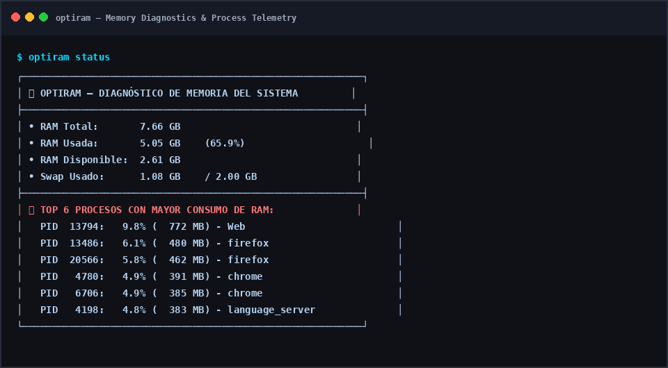

<div align="center">

# 🧠 OptiRAM
### Optimizador Universal de Memoria RAM y Procesos para Sistemas Linux


[](LICENSE)
[](https://github.com/darwinsin822/optiram)
[](#-evidencia-de-ejecución-en-vivo)
[](scripts/ci.sh)

</div>

**OptiRAM** es la herramienta y skill universal de contención de memoria RAM, diagnóstico de procesos y afinamiento automático de entornos de desarrollo (Android/Gradle, Node.js/Next/Vite, Python/ML, Rust/Cargo y C/C++). Previene la saturación del sistema, elimina procesos devoradores de RAM huérfanos y aplica presupuestos de memoria estrictos antes de que el kernel sufra congelamientos por swap.

---

## 📊 Evidencia de Ejecución en Vivo

A continuación se muestra la telemetría real obtenida por el motor de diagnóstico de OptiRAM en tiempo real:

<div align="center">
  
</div>

---

## 🛠️ Capacidades por Stack

| Stack / Proyecto | Acciones de OptiRAM |
| :--- | :--- |
| **Android / Gradle** | Reduce heap JVM de 4GB a 1536MB, activa G1GC, limita `workers.max=2`, desactiva daemons persistentes y paralelismo desmedido. |
| **Node.js / React / Vite** | Fija `NODE_OPTIONS="--max-old-space-size=2048"`, purga instancias de `tsserver` y watchers huérfanos. |
| **Python / ML** | Purgado de zombies de `multiprocessing` e `ipykernel`, configuración de `MALLOC_ARENA_MAX=2` y `OMP_NUM_THREADS=2`. |
| **Rust / Cargo** | Inyecta `.cargo/config.toml` con `jobs = 2` para evitar desbordes de memoria al compilar crates masivos. |
| **Linux Mint / Kernel** | Telemetría en vivo (RAM total, usada, disponible, swap) y Top de procesos acaparadores de recursos. |

---

## 🚀 Instalación y Despliegue Rápido

Para instalar OptiRAM globalmente en tu sistema (`~/.local/bin/optiram`) y como skill en Google Antigravity 2.0:

```bash
git clone https://github.com/darwinsin822/optiram.git
cd optiram
./scripts/install.sh
```

Para ejecutar las pruebas de integridad deterministas:
```bash
./scripts/ci.sh
```

---

## 💻 Uso de la CLI

```bash
# Diagnóstico en tiempo real y Top de procesos
optiram status

# Limpieza y purga de daemons huérfanos
optiram clean

# Auto-afinar presupuesto de memoria de un proyecto
optiram tune /ruta/al/proyecto

# Ejecutar una compilación con presupuesto acotado de RAM
optiram run ./gradlew assembleDebug
optiram run npm run build
optiram run cargo build --release
```

---

## 📄 Licencia

Distribuido bajo la Licencia MIT. Consulta el archivo `LICENSE` para más información.
